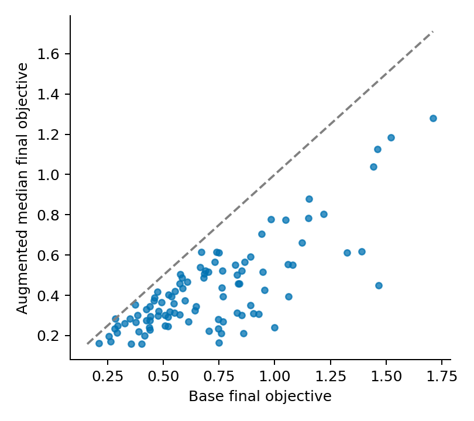
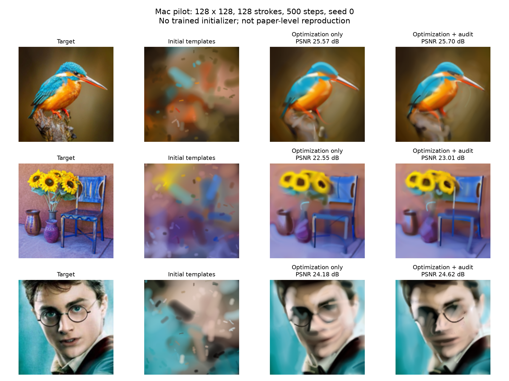
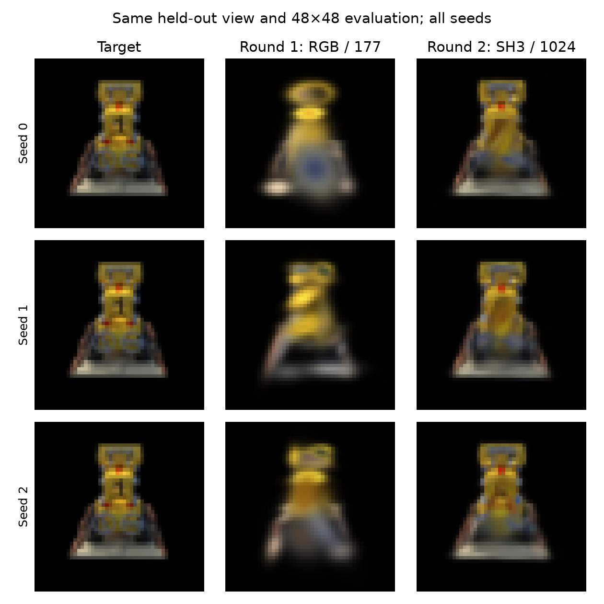
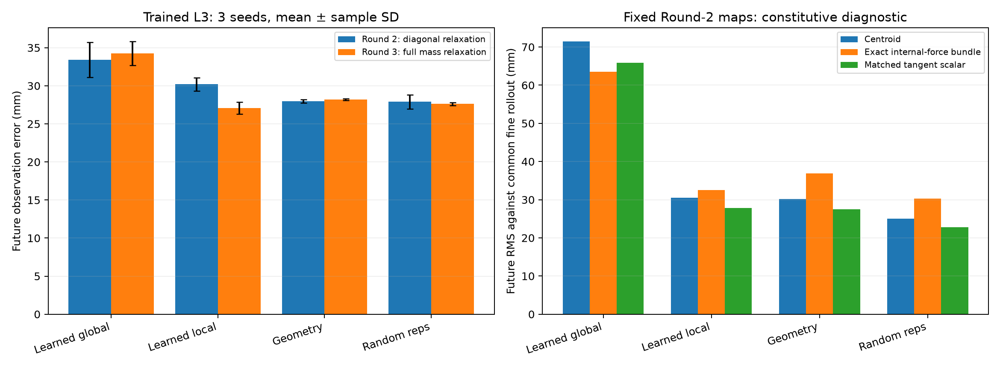
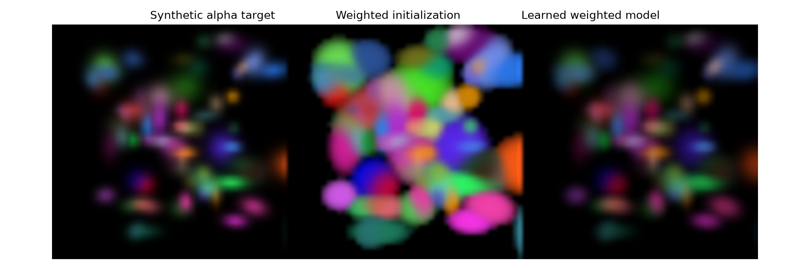
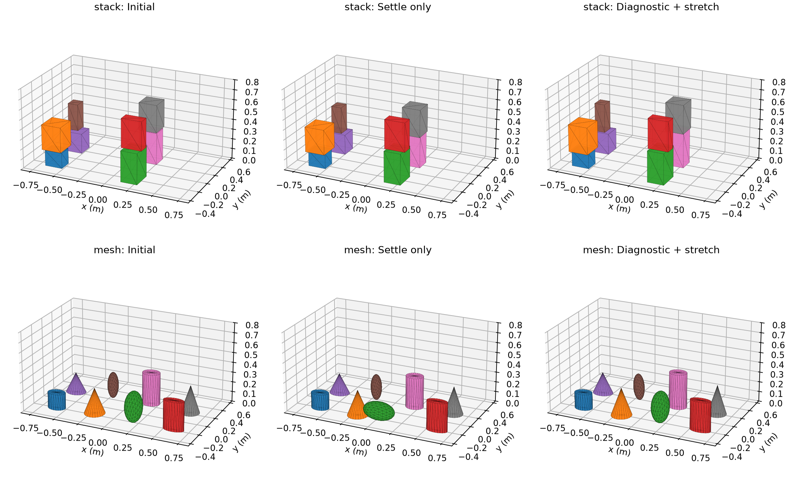
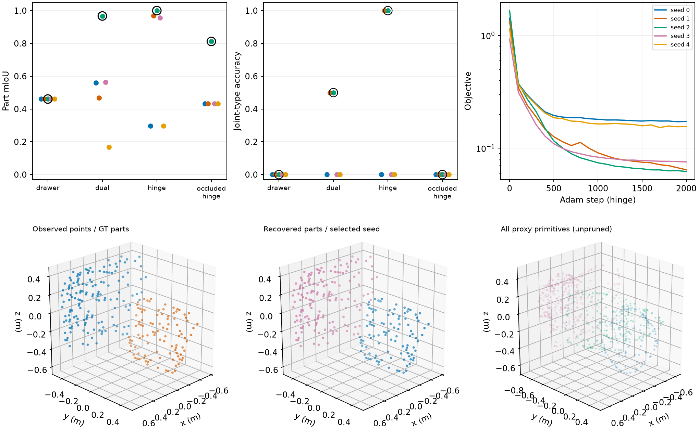
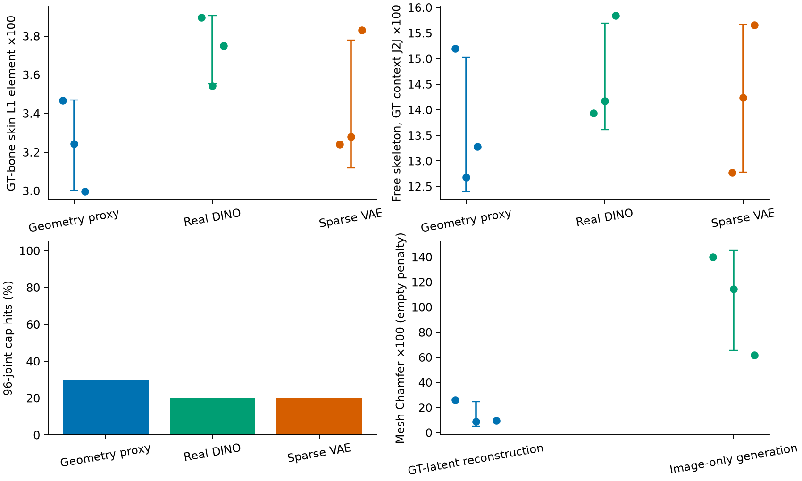

<!-- Generated by scripts/build_readme.py. Edit data/projects.json first. -->
<div align="center">

<h1>Research Reproductions</h1>

<p><strong>From papers to implementations. From experiments to evidence.</strong></p>

<p>Independent algorithms · CPU & Apple Silicon · Documented results and limitations</p>

<p>


<a href="https://github.com/gulucaptain/Research-Reproductions/actions/workflows/checks.yml"></a>
<a href="LICENSE"></a>
</p>

<p><a href="https://research-reproductions.gulucaptain666.chatgpt.site">🌐 Project page</a> · <a href="#paper-index">📚 Paper index</a> · <a href="#result-previews">🖼️ Result previews</a> · <a href="#progress">🔎 Progress policy</a> · <a href="docs/ADDING_PROJECT.md">➕ Add a project</a></p>

</div>

A growing collection of independent research-method implementations with traceable configurations, experiments and evidence. Each paper keeps its own code, dependencies and experiment archive in a separate repository; this repository provides the shared index and presentation layer.

> [!IMPORTANT]
> The projects below have remaining reproduction gaps. Implemented code, completed experiments, similar trends and matching paper numbers are different claims. The local results below do not establish full reproduction of the original papers.

**Last reviewed:** 2026-11-17. Repository evidence is pinned to the reviewed commits; live repository and report links may subsequently change.

<a id="paper-index"></a>
## 📚 Paper index

| Paper | Focus / compute | Reproduction progress | Links |
|:--|:--|:--|:--|
| **Achieving Directional-Stationarity from a Single Random Direction Step** | Optimization<br>CPU | **Partial reproduction**<br>Public experiment scales run | [Paper](https://arxiv.org/abs/2605.22045) · [GitHub](https://github.com/gulucaptain/Directional-Stationarity-Reproduction) · [Results](https://github.com/gulucaptain/Directional-Stationarity-Reproduction/blob/main/results/report-v2/summary.json) |
| **Quadratic Bezier Splatting with Structural Initialization for Efficient Painting Rendering** | Rendering<br>CPU + Apple Silicon | **Partial reproduction**<br>Core + local experiments | [Paper](https://arxiv.org/abs/2611.10713) · [GitHub](https://github.com/gulucaptain/Quadratic-Bezier-Splatting-Reproduction) · [Results](https://github.com/gulucaptain/Quadratic-Bezier-Splatting-Reproduction/blob/main/docs/results.md) |
| **KoalaGS: Complexity-Aware Continuous Level of Detail for Gaussian Splatting** | 3D Vision<br>CPU + Apple Silicon | **Partial reproduction**<br>Core + local experiments | [Paper](https://arxiv.org/abs/2610.28615) · [GitHub](https://github.com/gulucaptain/KoalaGS-Reproduction) · [Results](https://github.com/gulucaptain/KoalaGS-Reproduction/blob/main/results/expanded_report/results.md) |
| **PhySPRING: Structure-Preserving Reduction of Physics-Informed Twins via GNN** | Physics<br>CPU + Apple Silicon | **Partial reproduction**<br>Core + local experiments | [Paper](https://arxiv.org/abs/2605.07687) · [GitHub](https://github.com/gulucaptain/PhySPRING-Reproduction) · [Results](https://github.com/gulucaptain/PhySPRING-Reproduction/blob/main/results/round3/results.md) |
| **MatrixSplat: Matrix-Parallel and Feature-Scalable 3D Gaussian Splatting Rendering on GPUs** | Rendering<br>CPU + Apple Silicon | **Partial reproduction**<br>Components + local experiments | [Paper](https://arxiv.org/abs/2611.15153) · [GitHub](https://github.com/gulucaptain/MatrixSplat-Reproduction) · [Results](https://github.com/gulucaptain/MatrixSplat-Reproduction/blob/main/results/round05/REPORT.md) |
| **SimuScene: Simulation-Ready Compositional 3D Scene Reconstruction from a Single Image** | Physics<br>CPU | **Partial reproduction**<br>Components + local experiments | [Paper](https://arxiv.org/abs/2606.03994) · [GitHub](https://github.com/gulucaptain/SimuScene-Reproduction) · [Results](https://github.com/gulucaptain/SimuScene-Reproduction/blob/main/results/round05/REPORT.md) |
| **Articulation in Prime: Primitive-Based Articulated Object Understanding from a Single Casual Video** | 3D Vision<br>CPU + Apple Silicon | **Partial implementation**<br>Core audit + one original Arti4D cue; code not published | [Paper](https://arxiv.org/abs/2605.18645) · Implementation not published · [Results](https://github.com/gulucaptain/Research-Reproductions/blob/826c7f1d68b9f49e85734a6b4df4889e39f1f182/docs/reports/articulation-in-prime.md) |
| **Rigel3D: Rig-aware Latents for Animation-Ready 3D Asset Generation** | 3D Vision<br>CPU + Apple Silicon | **Partial reproduction**<br>Official TRELLIS priors + short full-weight joint stage; single-image quality unresolved | [Paper](https://arxiv.org/abs/2605.13129) · Implementation not published · [Results](https://github.com/gulucaptain/Research-Reproductions/blob/af25dc8168b07a6b9f7a0b6d10407b779fa54ae3/docs/reports/rigel3d.md) |

<a id="result-previews"></a>
## 🖼️ Result previews

Previews come from the documented local experiments, with scope and limitations; they are not official paper figures. For unpublished implementations, the collection stores a reviewed result snapshot and does not imply publicly available code. [Figure provenance and SHA-256](data/preview-sources.json).

### 01 · Achieving Directional-Stationarity from a Single Random Direction Step [Reproduction]

[](https://github.com/gulucaptain/Directional-Stationarity-Reproduction/blob/main/results/report-v2/summary.json)

*Trimmed Lasso local trajectories; representative instance, not the original paper instance.*

| | Local evidence |
|:--|:--|
| 🧩 **Implemented** | REP exploration, DCA baselines, ReLU proximal models and stationarity diagnostics. |
| 🧪 **Validation** | 400 instances · 1,900 runs · all publicly reported experiment scales executed. |
| 📊 **Finding** | Trimmed Lasso: 99 wins / 1 tie / 0 losses, matching the reported count; overall numerical results still differ. |
| 🔎 **Remaining gaps** | Some counts match; overall numerical results differ. Several original settings remain unspecified. |

[📄 Paper](https://arxiv.org/abs/2605.22045) · [💻 Repository](https://github.com/gulucaptain/Directional-Stationarity-Reproduction) · [📊 Report](https://github.com/gulucaptain/Directional-Stationarity-Reproduction/blob/main/results/report-v2/summary.json) · [📌 Reviewed evidence](https://github.com/gulucaptain/Directional-Stationarity-Reproduction/tree/4f3e3748195869b84d22d0df5de8ee7752d095ad)

**Pinned evidence:** [results/report-v2/summary.json](https://github.com/gulucaptain/Directional-Stationarity-Reproduction/blob/4f3e3748195869b84d22d0df5de8ee7752d095ad/results/report-v2/summary.json) · [docs/comparison.md](https://github.com/gulucaptain/Directional-Stationarity-Reproduction/blob/4f3e3748195869b84d22d0df5de8ee7752d095ad/docs/comparison.md)

### 02 · Quadratic Bezier Splatting with Structural Initialization for Efficient Painting Rendering [Reproduction]

[](https://github.com/gulucaptain/Quadratic-Bezier-Splatting-Reproduction/blob/main/docs/results.md)

*Three-image local comparison at 128×128 with 128 strokes; no trained initializer.*

| | Local evidence |
|:--|:--|
| 🧩 **Implemented** | Analytic Bézier rendering, stroke auditing, adaptive optimization and initializer architecture. |
| 🧪 **Validation** | Three-image, three-seed paired pilot · 18 runs · CPU/MPS numerical checks. |
| 📊 **Finding** | Stroke auditing: +0.2309 dB mean paired PSNR across 9 pairs; 8 improve and 1 declines. |
| 🔎 **Remaining gaps** | No completed learned-initializer training, full benchmark or paper-equivalent CUDA speedup. |

[📄 Paper](https://arxiv.org/abs/2611.10713) · [💻 Repository](https://github.com/gulucaptain/Quadratic-Bezier-Splatting-Reproduction) · [📊 Report](https://github.com/gulucaptain/Quadratic-Bezier-Splatting-Reproduction/blob/main/docs/results.md) · [📌 Reviewed evidence](https://github.com/gulucaptain/Quadratic-Bezier-Splatting-Reproduction/tree/ccd939e900b0cefff1aa30d3e0e7cbfe267852b0)

**Pinned evidence:** [results/pilot_summary.csv](https://github.com/gulucaptain/Quadratic-Bezier-Splatting-Reproduction/blob/ccd939e900b0cefff1aa30d3e0e7cbfe267852b0/results/pilot_summary.csv) · [docs/results.md](https://github.com/gulucaptain/Quadratic-Bezier-Splatting-Reproduction/blob/ccd939e900b0cefff1aa30d3e0e7cbfe267852b0/docs/results.md)

### 03 · KoalaGS: Complexity-Aware Continuous Level of Detail for Gaussian Splatting [Reproduction]

[](https://github.com/gulucaptain/KoalaGS-Reproduction/blob/main/results/expanded_report/results.md)

*All three seeds at common 48×48 evaluation; two training rounds use different capacities.*

| | Local evidence |
|:--|:--|
| 🧩 **Implemented** | Complexity-aware relocation, prefix training, variance regularization and SH3 rendering. |
| 🧪 **Validation** | Two local experiment rounds · 12 expanded training runs · CPU/MPS checks. |
| 📊 **Finding** | SH3 vs SH0: +1.102 PSNR AUC. KoalaGS vs prefix: +0.040 on average, two seeds win and one loses. |
| 🔎 **Remaining gaps** | Small-scale Lego evaluation; relative prefix-baseline advantage is not consistent across seeds. |

[📄 Paper](https://arxiv.org/abs/2610.28615) · [💻 Repository](https://github.com/gulucaptain/KoalaGS-Reproduction) · [📊 Report](https://github.com/gulucaptain/KoalaGS-Reproduction/blob/main/results/expanded_report/results.md) · [📌 Reviewed evidence](https://github.com/gulucaptain/KoalaGS-Reproduction/tree/c71666958cff0b97b15684dcb4df786b7e9fcdcd)

**Pinned evidence:** [results/expanded_report/summary.json](https://github.com/gulucaptain/KoalaGS-Reproduction/blob/c71666958cff0b97b15684dcb4df786b7e9fcdcd/results/expanded_report/summary.json) · [results/expanded_report/results.md](https://github.com/gulucaptain/KoalaGS-Reproduction/blob/c71666958cff0b97b15684dcb4df786b7e9fcdcd/results/expanded_report/results.md)

### 04 · PhySPRING: Structure-Preserving Reduction of Physics-Informed Twins via GNN [Reproduction]

[](https://github.com/gulucaptain/PhySPRING-Reproduction/blob/main/results/round3/results.md)

*Real cloth subset and force diagnostics; panels use different metrics and cannot be compared directly.*

| | Local evidence |
|:--|:--|
| 🧩 **Implemented** | Hierarchical GNN reduction, mechanical projection, frozen topology and differentiable rollouts. |
| 🧪 **Validation** | Three local rounds · 18 latest real-subset runs · force/gradient and replay audits. |
| 📊 **Finding** | Local learned L3: 27.08 ± 0.79 mm future observation error; independent tracks still favor geometry. |
| 🔎 **Remaining gaps** | One cloth subset; independent tracks still favor geometry. Full paper benchmarks remain incomplete. |

[📄 Paper](https://arxiv.org/abs/2605.07687) · [💻 Repository](https://github.com/gulucaptain/PhySPRING-Reproduction) · [📊 Report](https://github.com/gulucaptain/PhySPRING-Reproduction/blob/main/results/round3/results.md) · [📌 Reviewed evidence](https://github.com/gulucaptain/PhySPRING-Reproduction/tree/11bf3814d84042dd7bcfa2a5e258d00e5a85a480)

**Pinned evidence:** [results/round3/results.md](https://github.com/gulucaptain/PhySPRING-Reproduction/blob/11bf3814d84042dd7bcfa2a5e258d00e5a85a480/results/round3/results.md) · [results/round3/sparse_gt.json](https://github.com/gulucaptain/PhySPRING-Reproduction/blob/11bf3814d84042dd7bcfa2a5e258d00e5a85a480/results/round3/sparse_gt.json)

### 05 · MatrixSplat: Matrix-Parallel and Feature-Scalable 3D Gaussian Splatting Rendering on GPUs [Reproduction]

[](https://github.com/gulucaptain/MatrixSplat-Reproduction/blob/main/results/round05/REPORT.md)

*Held-out synthetic rendering; fixed geometry, local appearance/blending optimization.*

| | Local evidence |
|:--|:--|
| 🧩 **Implemented** | Weighted matrix rendering, tiled accumulation, channel slicing and differentiable projection. |
| 🧪 **Validation** | Five local cycles · five training seeds · 144 final GPU benchmark configurations. |
| 📊 **Finding** | Held-out RGB PSNR: 10.66 → 33.21 dB across 5 synthetic training seeds. 144 GPU timing configurations. |
| 🔎 **Remaining gaps** | No NVIDIA kernel, official datasets or paper-equivalent speed comparisons. |

[📄 Paper](https://arxiv.org/abs/2611.15153) · [💻 Repository](https://github.com/gulucaptain/MatrixSplat-Reproduction) · [📊 Report](https://github.com/gulucaptain/MatrixSplat-Reproduction/blob/main/results/round05/REPORT.md) · [📌 Reviewed evidence](https://github.com/gulucaptain/MatrixSplat-Reproduction/tree/2229a8199fbb53a8bd2c3da6720c1ac1646d6801)

**Pinned evidence:** [results/round05/REPORT.md](https://github.com/gulucaptain/MatrixSplat-Reproduction/blob/2229a8199fbb53a8bd2c3da6720c1ac1646d6801/results/round05/REPORT.md) · [COVERAGE.md](https://github.com/gulucaptain/MatrixSplat-Reproduction/blob/2229a8199fbb53a8bd2c3da6720c1ac1646d6801/COVERAGE.md)

### 06 · SimuScene: Simulation-Ready Compositional 3D Scene Reconstruction from a Single Image [Reproduction]

[](https://github.com/gulucaptain/SimuScene-Reproduction/blob/main/results/round05/REPORT.md)

*Procedural scenes before and after geometry/physics correction; not image-to-scene reconstruction.*

| | Local evidence |
|:--|:--|
| 🧩 **Implemented** | Sequential placement, penetration correction, gravity diagnostics and attachment constraints. |
| 🧪 **Validation** | Five local cycles · 64 seeds · eight scene families · 2,048 final synthetic runs. |
| 📊 **Finding** | Synthetic stack IoU: 0.89443 → 0.99660. Pose-only errors worsen; severe cases remain unresolved. |
| 🔎 **Remaining gaps** | Geometry/physics components only; no complete image-to-scene pipeline or original benchmarks. |

[📄 Paper](https://arxiv.org/abs/2606.03994) · [💻 Repository](https://github.com/gulucaptain/SimuScene-Reproduction) · [📊 Report](https://github.com/gulucaptain/SimuScene-Reproduction/blob/main/results/round05/REPORT.md) · [📌 Reviewed evidence](https://github.com/gulucaptain/SimuScene-Reproduction/tree/3ebf35bf6119131de20a6b6a2b33985a30e50c21)

**Pinned evidence:** [results/round05/REPORT.md](https://github.com/gulucaptain/SimuScene-Reproduction/blob/3ebf35bf6119131de20a6b6a2b33985a30e50c21/results/round05/REPORT.md) · [COVERAGE.md](https://github.com/gulucaptain/SimuScene-Reproduction/blob/3ebf35bf6119131de20a6b6a2b33985a30e50c21/COVERAGE.md)

### 07 · Articulation in Prime: Primitive-Based Articulated Object Understanding from a Single Casual Video [Reproduction]

[](https://github.com/gulucaptain/Research-Reproductions/blob/826c7f1d68b9f49e85734a6b4df4889e39f1f182/docs/reports/articulation-in-prime.md)

*Top: procedural hinge, 8×256 points, five seeds per setting, 2000 steps; rings mark minimum loss; extra refit is separate. Bottom left: one original Arti4D cue, 25×512 core input, three seeds per setting; bottom right: extent4 seed2 pruning losses. No original table matched.*

| | Local evidence |
|:--|:--|
| 🧩 **Implemented** | Corrected angular SQ mesh, reversible observation-only normalization, all original losses, CPU rasterization plus continuous-SQ oracle, and explicit coverage-aware pruning; SAM2/GMSF RGB-D preprocessing. |
| 🧪 **Validation** | 14 tests · 25 paired procedural audit runs · six original Arti4D pilot fits · 25 audit and six real objectives replayed; initial 30 runs retained. |
| 📊 **Finding** | Scale sensitivity reduces one selected procedural pivot/state error to 8.47 cm / 6.59°, but only 1/5 types is correct. Original Arti4D weights: 0/3 correct types; no-motion: 1/3, selected axis 28.79° and pivot 39.67 cm. |
| 🔎 **Remaining gaps** | Joint bias and collapse remain. One 25×512 RGB-D cue pilot, not the author 11-object benchmark or full 10k configuration. Unknown normalization/pruning; no GT states/labels. Video2Articulation-S Pending; code unpublished. |

[📄 Paper](https://arxiv.org/abs/2605.18645) · **Implementation not published** · [📊 Report](https://github.com/gulucaptain/Research-Reproductions/blob/826c7f1d68b9f49e85734a6b4df4889e39f1f182/docs/reports/articulation-in-prime.md) · [📌 Reviewed evidence](https://github.com/gulucaptain/Research-Reproductions/tree/826c7f1d68b9f49e85734a6b4df4889e39f1f182)

**Pinned evidence:** [data/evidence/articulation-in-prime-round2.json](https://github.com/gulucaptain/Research-Reproductions/blob/826c7f1d68b9f49e85734a6b4df4889e39f1f182/data/evidence/articulation-in-prime-round2.json) · [docs/reports/articulation-in-prime.md](https://github.com/gulucaptain/Research-Reproductions/blob/826c7f1d68b9f49e85734a6b4df4889e39f1f182/docs/reports/articulation-in-prime.md)

### 08 · Rigel3D: Rig-aware Latents for Animation-Ready 3D Asset Generation [Reproduction]

[](https://github.com/gulucaptain/Research-Reproductions/blob/af25dc8168b07a6b9f7a0b6d10407b779fa54ae3/docs/reports/rigel3d.md)

*Fixed25 train/6 validation/10 test cohort. Top: GT-conditioned mesh/free-skeleton tasks; official model and GT-support shell are fixed controls, other dots are three seeds with sample SD. Bottom: strict single-image full-weight-stage generation, standard MSE versus changed foreground-balanced diagnostic. Nonempty pipelines are not fidelity. No raw asset images.*

| | Local evidence |
|:--|:--|
| 🧩 **Implemented** | Strict official encoder/mesh/occupancy VAE loads with native CPU/MPS kernels; frozen surface latents, full rig/mesh weight updates, coupled flows and foreground-loss diagnostic. |
| 🧪 **Validation** | 28 tests; fixed25/6/10 assets;3 seeds per stage;3 full rig/mesh and12 flow CPU/MPS probes; frozen-surface/hash checks and GT-support controls. |
| 📊 **Finding** | GT occupancy IoU0.984/1.000; official GT mesh CD×100=0.987 vs GT-support shell1.311. Full joint J2J×100=14.091±1.056, caps15/30. Strict standard generation5/30 completed; changed balanced loss23/30, but rig IoU only0.003212. |
| 🔎 **Remaining gaps** | Short250-step full-weight stage after2000 adapter steps,16-cube SDF patches, upsampled224 neutral views and compact fresh flows. Original pretrained flow transformers/rendering losses/convergence absent; geometry/EOS still wrong. No paper table matched; code/data local. |

[📄 Paper](https://arxiv.org/abs/2605.13129) · **Implementation not published** · [📊 Report](https://github.com/gulucaptain/Research-Reproductions/blob/af25dc8168b07a6b9f7a0b6d10407b779fa54ae3/docs/reports/rigel3d.md) · [📌 Reviewed evidence](https://github.com/gulucaptain/Research-Reproductions/tree/af25dc8168b07a6b9f7a0b6d10407b779fa54ae3)

**Pinned evidence:** [data/evidence/rigel3d-round3.json](https://github.com/gulucaptain/Research-Reproductions/blob/af25dc8168b07a6b9f7a0b6d10407b779fa54ae3/data/evidence/rigel3d-round3.json) · [docs/reports/rigel3d.md](https://github.com/gulucaptain/Research-Reproductions/blob/af25dc8168b07a6b9f7a0b6d10407b779fa54ae3/docs/reports/rigel3d.md)

<a id="progress"></a>
## 🔎 How progress is reported

| Claim | Meaning |
|:--|:--|
| Implementation | The stated method components have executable code. |
| Local experiments | Recorded runs verify behavior under explicitly scoped local settings. |
| Paper-scale experiments | The original experiment scale has been run; undisclosed settings and numerical differences may remain. |
| Numerical match | A particular metric or count matches under a specified comparison; this does not imply full-paper reproduction. |
| Full reproduction | Requires the agreed paper coverage and matching conclusions with remaining discrepancies clearly resolved. No initial project claims this. |

Experiment counts use different definitions across papers and are not added into a single achievement total. CPU/Apple GPU results are not treated as reproductions of NVIDIA kernel performance. Negative seeds, unresolved cases and missing baselines remain visible.

## 🖥️ Project page

**[Visit the public project page](https://research-reproductions.gulucaptain666.chatgpt.site)** — the selected research publication layout, with area filters, keyword search, enlarged result figures and pinned evidence. The website and this README are generated from the same reviewed project registry. [Design history](design-demos/README.md).

## 🔁 Maintain the collection

The reviewed registry is [data/projects.json](data/projects.json). Add a record, a preview with provenance, and evidence links; then regenerate the README:

```sh
python3 scripts/build_readme.py
python3 scripts/build_readme.py --check
python3 scripts/build_site.py
```

No third-party Python packages or API keys are required. These commands rebuild the index and static website; it does not rerun experiments or automatically assert that upstream results are current. See [adding a project](docs/ADDING_PROJECT.md) and [evidence policy](docs/EVIDENCE_POLICY.md).

## 📚 Citation and license

Cite each original paper when using its method, and consult the linked reproduction repository for software citation metadata. Original collection code and documentation are licensed under [MIT](LICENSE); original papers, data and third-party material retain their own terms. Experiment previews may contain small reference-view excerpts; see [NOTICE](NOTICE).
