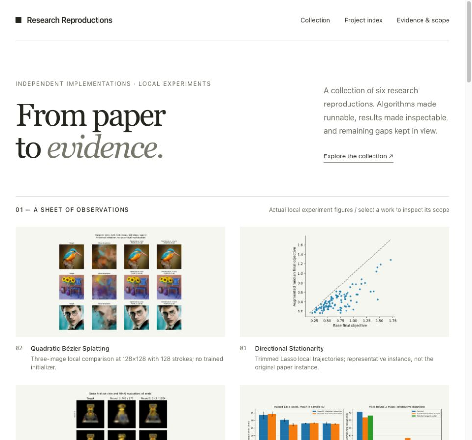
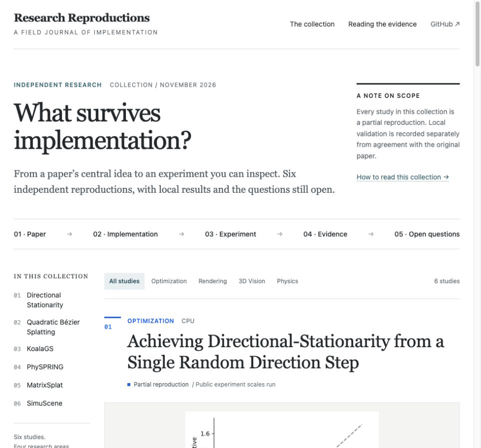
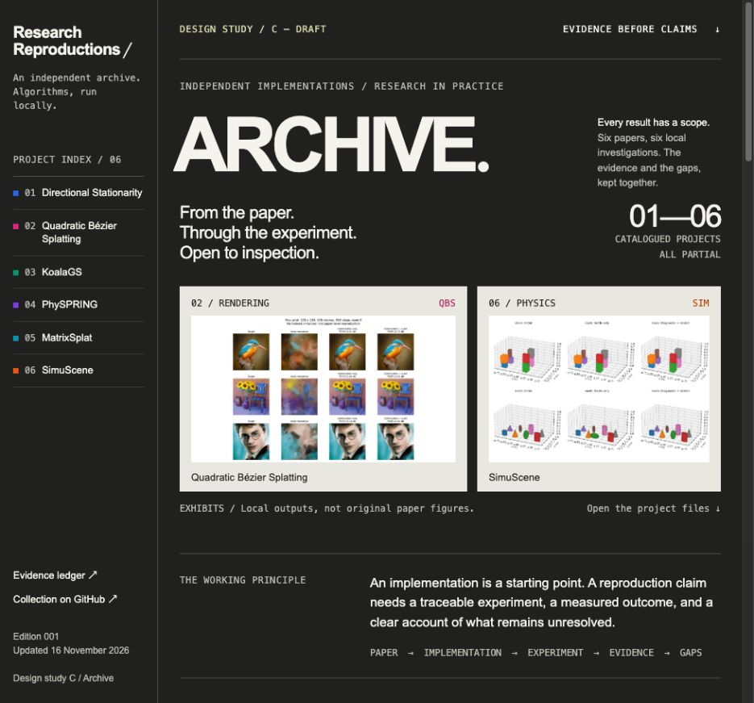

# Website concepts — awaiting selection

Three responsive HTML drafts explore the same reviewed collection. These are visual directions, not a finished deployed website.

- [A · White research gallery](a-gallery.html): curated image sheet and editorial project index.
- [B · Research publication](b-publication.html): scientific reading, browsing and experiment context.
- [C · Evidence archive](c-archive.html): dark folio, project identities and evidence ledger.

| A · White gallery | B · Research publication | C · Evidence archive |
|:--|:--|:--|
|  |  |  |

To view locally, run `python3 -m http.server 8000` from the repository root, then open `http://localhost:8000/design-demos/a-gallery.html` (or B/C). All result images come from `assets/previews`, with provenance in `data/preview-sources.json`.

The final website will be built after a direction is selected. It will use the shared project registry so future papers can be added without hand-copying facts into every page.
