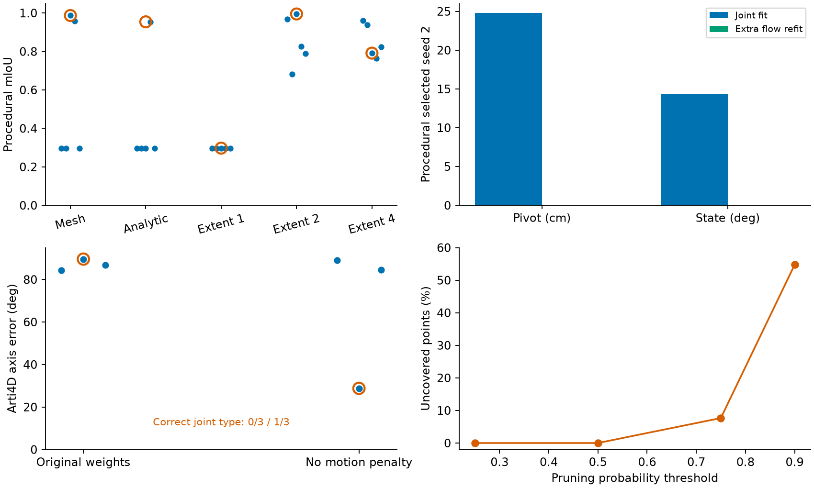

# Articulation in Prime — second reviewed snapshot

Reviewed 2026-11-16. Local implementation commit: `15cfe94a2efdb117ab270684bb68e2eed919bb98`.

**Implementation not published.** This collection provides numerical evidence and an aggregate result figure, not the unpublished implementation, raw data, learned parameters or weights. It cannot independently replay optimization. No original paper table is reproduced.

14 tests passed. All 25 paired procedural objectives and six original Arti4D pilot objectives replayed within 1e-5; the eight previously selected legacy runs still replay. The v1 parameter-snapshot recovery and its limitations are documented below.

Original Arti4D fits: original weights 0/3 correct moving types; no-motion control 1/3. Its minimum-loss seed has 28.7943° axis error and 39.6713 cm pivot error. This is a 25×512 core pilot (Q6/P4, 128 surface samples, 2000 steps), after SAM2/GMSF preprocessing at 25×4096 points. No motion-state MAE or segmentation mIoU is claimed without GT.



Top: procedural hinge, 8×256, five seeds per setting, 2000 steps; rings mark minimum loss. Extra refit is separate from AiP. Bottom left: one original Arti4D cue, three seeds per weight setting, 25×512; bottom right: extent4 seed2 pruning coverage. No raw RGB image or original-paper figure is reproduced here.

# 第二轮：尺度、运动、遮挡和剪枝核查

审阅：2026-11-16。原文依据为 arXiv:2605.18645v1 的完整 LaTeX 源码；哈希见 `sources/manifest.json`。数值与全部失败种子见 `results/round2/summary.json`。**本轮没有解决原始联合目标下的稳定关节恢复，也没有复现论文表格。**

## 原文已确认的设置

1. Appendix A.3 使用球面角度到 SQ 的显式映射构造网格；Appendix A.2 的径向映射只用于损失表面采样。初版错误地把径向映射同时用于网格。本轮新增独立 `sq_mesh`，并使用每级归一化的单位 icosphere；旧配置默认仍保留旧行为，以便回放历史实验。修正网格并不能单独修复运动偏差。
2. 运动正则是相邻**绝对状态**的平方差之和：`sum_t,p (theta[t+1,p]-theta[t,p])²`，不是二阶加速度，也不是按帧或部件平均；Appendix B 权重为 0.1。现有实现与此一致，没有把这个权重悄悄调小。
3. 原文及源码注释未提供物体尺度归一化、完整初始位姿分布、网格细分级数、渲染分辨率或深度容差。初始 SQ scale=0.5 不能证明作者使用米或单位包围盒。
4. 原文优化 alpha/beta，并在最后阈值化存在概率；未给 tau_alpha/tau_beta 数值。Eq.17 使用点分配权重的未归一化总和，而结尾又用同名 tau_alpha 阈值化概率。不能从文字唯一推导作者的最终剪枝。

## 尺度为什么会改变转角及 pivot

本轮可逆变换 `x'=(x-c)/s` 中，c 和 s 仅由观测包围盒决定；点、flow、相机平移同时变换，输出再恢复米制。归一化投影及反变换通过单元测试。原文未披露的 target extent=1/2/4 均明确标为敏感性设置。

变换后平方重建项按 1/s² 缩放、L1 flow 按 1/s 缩放；旋转状态正则不随长度缩放，滑动状态正则按 1/s² 缩放。因此固定论文权重的目标不具备长度单位不变性；特征坐标和初始化尺度也会改变优化轨迹。不同 extent 的总损失不可横向用来选“最佳尺度”。

局部近似 `flow ≈ Δtheta * axis × (x-pivot)` 解释了角速度与杠杆臂的补偿：压小转角可由移动 pivot 部分补偿。历史 oracle（只分析 flow+motion，使用 GT，绝不参与拟合）在原几何尺度下偏好 0.665 倍真实转角，而放大 2 倍时偏好 1.0。它支持正则引起收缩的解释，不证明所有误差均由正则造成。

## 25 次配对实验

固定 hinge 8×256 输入、Q6/P4、128 表面点、2000 步、种子 0–4；各配置分别按原总损失选种子。保留所有缺失部件与错误类型。

| 设置 | 选中种子 | 平均 mIoU（5 种子） | 缺失运动部件次数 | 正确运动类型次数 | 选中 pivot cm / state ° |
|---|---:|---:|---:|---:|---|
| 修正网格 + Z-buffer | 2 | 0.5676 | 3/5 | 1/5 | 24.7904 / 14.3657 |
| 连续 SQ 遮挡 | 3 | 0.4287 | 4/5 | 0/5 | 错误类型，不报告 |
| 连续遮挡 + extent=1 | 1 | 0.2974 | 5/5 | 0/5 | 缺失，不报告 |
| 连续遮挡 + extent=2 | 2 | 0.8524 | 0/5 | 1/5 | 8.4735 / 6.5862 |
| 连续遮挡 + extent=4 | 2 | 0.8557 | 0/5 | 0/5 | 错误类型，不报告 |

extent=2 的选中结果改善，但仅 1/5 种子类型正确；extent=4 仍全部类型错误。因此不能宣称已经找回作者的归一化设置。

## 观测流关节重估：单独报告的附加诊断

固定学习得到的部件权重，按相邻帧做稳健加权 Kabsch，从旋转增量估计公共轴，并解 `(I-R) pivot = translation`，沿轴方向选最小范数规范，累积转角。此函数不接收 GT。它是独立附加步骤，**不是论文已披露算法**。

修正网格 seed2 上，pivot 误差从 24.7904 cm 降到约 1.35e-5 cm、state 从 14.3657° 降到约 5.12e-6°。但完整原目标从 0.056828 升至 0.066531：flow 项从 0.008381 降至 0.000440，未加权 motion 从 0.082553 升至 0.249567；重建项也轻微变差。这是精确流诊断的运动恢复，不能取代联合目标复现，更不能证明真实 GMSF 流有同等精度。

v2 修正了附加诊断中静态类型判定的软权重污染，采用与稳健刚体拟合同一支持集；v1 原结果仍保留。轴角测量改用双精度单位向量和 `atan2(||cross||,abs(dot))`，消除 float32 acos 的近零量化误差；旧值保留为 `legacy_metrics`。这些测量修正不解释大幅 pivot/state 偏差。

## 遮挡和剪枝的结论

连续 SQ 方法独立计算自可见性和相机线段与其他凸 SQ 的相交。球体解析光线和遮挡测试通过。固定拟合 SQ 上，比较 level1/2/3、128/256 分辨率及 0.001/0.01/0.025 深度容差；跨物体遮挡仅在两种方法都自可见的点上比较，详见 `visibility_sensitivity.json`。该对照不证明与 Nvdiffrast 等同；更精确的几何判定也未使所有优化成功。

显式剪枝实现对 alpha/beta 阈值化，可硬化 primitive→part 分配，再对保留的质量重新归一化。没有覆盖的点保留 -1，绝不 argmax 成部件 0。四个阈值 0.25/0.5/0.75/0.9 全部报告；extent4 的选中结果在 0.75 时丢失 7.67% 点，在 0.9 时丢失 54.74% 点。剪枝不能修复关节状态，且不能冒充已知作者协议。

## 参数回放与已修复的保存错误

初版 round2 脚本在 CPU 上让 NumPy 状态快照共享模型内存，又在保存前修改诊断关节，导致其 `parameters.npz` 含附加重估后的关节。原 `prediction.npz` 未受影响，所有原始文件保留。现使用独立复制保存快照；历史运行从原预测恢复前向等价关节到 `parameters_forward_restored.npz`，25 次完整原目标均回放到 1e-5 内。原始未归一化轴的模长及优化器状态无法恢复，不声称精确恢复训练轨迹。专门的快照独立性测试防止复发。

## 继续与范围限制

Arti4D 接入和真实结果见 the Arti4D section below。核心未解决问题是：联合目标的尺度敏感、部件塌缩和旋转/平移候选混淆。继续推进完整论文配置前，需把这些失败与原始数据质量分开核查；目前不能把附加重估的好结果称为论文数值匹配。


# Arti4D 原始数据实验

审阅：2026-11-16。官方来源：[ArtiPoint + Arti4D](https://github.com/robot-learning-freiburg/artipoint)。仅下载原始 rr080 第一场景的 white-box cue，25 帧均匀抽样覆盖帧 1789–1845。这不是论文未公开的 11 个代表物体列表；不能据此宣称复现 Table 4。

## 数据与模型

- 55 个原始成员文件经 ZIP CRC 与 SHA-256 校验；按 HTTP range 读取，避免下载完整 12.2 GB ZIP。文件名、索引和选择依据在 `configs/arti4d_whitebox.json`；校验清单在 `results/arti4d/{metadata,subset}-download.json`。原始 RGB-D、模型权重、登录缓存均不提交。
- SAM2.1-hiera-tiny：首帧人工箱体框及正负点提示，仅基于 RGB；25 帧传播。CUDA hole-filling 后处理禁用。局部检查显示末段关闭箱盖时有掩码遗漏，不能把分割当成精确 GT。
- 官方 ArtiPoint 相机链：`world_T_base @ base_T_depth @ depth_T_rgb @ Rz(180°)`；深度 /1000 转米，使用对齐深度 K，按官方代码不额外去畸变。相机跟踪时间最近匹配最大差约 4.86 ms。
- 独立静态背景检验：采用官方 flip 后相邻帧中位最近邻距离为 4.42 mm，未 flip 为 7.41 mm。该统计包含采样/深度误差，不是绝对定位精度证明。
- 官方 GMSF FTDc checkpoint 严格加载；唯一源码移植修改为硬编码 CUDA 设备改成输入设备。25×4096 点在同一首帧相机坐标下以米计算，流旋转回世界坐标。Mac MPS 上 24 对约 10.45 秒。未向 GMSF 或求解器输入真实 articulation 轴、pivot 或状态。
- 上游固定提交、移植补丁及权重 SHA-256 见 `sources/upstream-manifest.json`；依赖见 `requirements-real-lock.txt`。AiP 未披露 SAM2 具体型号、GMSF checkpoint 与完整输入预处理，因此这里均为显式实现选择。此 RGB-D 基准用原始深度和相机姿态，不代表 ViPE 单目端到端实现。

## 运行与核验

先按 `sources/upstream-manifest.json` 克隆、checkout 官方 `artipoint`、`GMSF`、`sam2` 到 `sources/upstream/`，下载清单给出的两个 checkpoint 并核对哈希。GMSF 仅应用清单中保存的单行设备补丁。SAM2 从其源码目录导入；安装 `torchvision`、`hydra-core`、`iopath`、`omegaconf` 及官方所需依赖。可在独立环境按 `requirements-real-lock.txt` 安装已验证的完整版本组合。

```sh
python scripts/bootstrap_arti4d.py          # 官方 range 下载并核对预期哈希
python scripts/bootstrap_arti4d.py --offline # 只验证已下载文件
python scripts/segment_arti4d.py --device mps
python scripts/prepare_arti4d.py --points 4096 --seed 100
python scripts/flow_arti4d.py --points 4096 --device mps
python scripts/run_arti4d.py --steps 2000 --points 512 --seeds 0 1 2 --name pilot
python scripts/run_arti4d.py --steps 2000 --points 512 --seeds 0 1 2 --name no_motion --no-motion
```

MPS 用于上游预处理，核心拟合首轮用 CPU。指定 MPS 的步骤须在可访问 Mac GPU 的环境运行，不假设受限后台进程可见 GPU。核心输入从 4096 点中用固定种子 101 抽取相同 512 点；25 帧、Q6/P4、128 表面点、320×180 可见性网格、2000 步，extent=2。它是明确缩小的真实数据 pilot，不是论文 Q10/P8、500 表面点、4096 点、10k 步。

目录存在完整 summary 时只在配置一致的情况下复用；不覆盖不完整运行，需另选 `--name` 保留历史。每种设置分别按完整拟合目标选种子；单对象的运动候选先按观测支持质量选取，不按真实轴误差选择。输出保留所有候选，因此不能用某个较好但未选中的旋转候选替换失败的主结果。

## 评价范围

当前原始发布元数据含 white-box 的轴和轴线上一点。其真实状态及逐点部件标签未在本次接入中取得，因此 mIoU、转角 MAE 均记为不可评价，不用人工推算状态冒充 GT。错误地预测为滑动时，不输出旋转 pivot 误差。完整逐种子结果与选择在 `results/arti4d/summary.json`（由报告脚本生成）。

首轮结果未实现可靠关节恢复。去运动正则是单独的诊断对照，不能冒充原方法；观测流重估也不能修复错误部件分割。需要继续核查 GMSF 在小物体开合、深度孔洞和掩码变化下的误差，以及部件塌缩；没有证据支持把剩余偏差归结为单一原因。

Video2Articulation-S 的账号申请仍是 Pending。用户已同意条款且授权官方客户端下载，但未把这解释为平台已批准访问；待获批后接入。


# Arti4D pilot — all executed seeds

One original Arti4D white-box cue; 25x512 core pilot, Q6/P4/M128, 2000 steps, three seeds; input GMSF from 25x4096

Minimum-loss selection is per variant; objectives with different weights are not comparable.

| Variant | Seed | Selected seed | Axis ° | Predicted type | Pivot cm | Flow-refit type | Flow-refit axis ° |
|---|---:|---|---:|---|---|---|---:|
| pilot | 0 |  | 84.3922 | prismatic | unavailable (wrong type) | prismatic | 36.1582 |
| pilot | 1 | yes | 89.6002 | prismatic | unavailable (wrong type) | prismatic | 39.9852 |
| pilot | 2 |  | 86.7748 | prismatic | unavailable (wrong type) | prismatic | 36.1582 |
| no_motion | 0 |  | 89.0950 | prismatic | unavailable (wrong type) | prismatic | 36.1582 |
| no_motion | 1 | yes | 28.7943 | revolute | 39.6713 | prismatic | 40.0934 |
| no_motion | 2 |  | 84.5132 | prismatic | unavailable (wrong type) | prismatic | 36.1582 |

Correct moving joint type: 0/3 with original weights, 1/3 without the motion penalty. A low objective alone does not establish correct kinematics. No state MAE or mIoU is reported without GT.

The extra flow refit is not the original AiP pipeline. Full reports retain every candidate and pruning outcome. Raw RGB-D and weights are not distributed.
